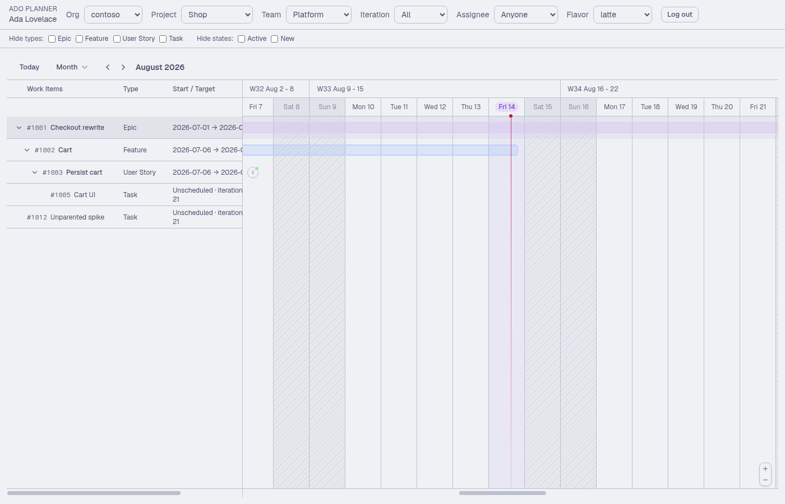

<p align="center">
  
</p>

<h1 align="center">ADO Planner</h1>

<p align="center"><strong>See the plan. Drag the dates. Azure DevOps stays in sync.</strong></p>

<p align="center">
  A Monday-style Gantt for your Azure DevOps Team — Epic down to Task, on one timeline,<br>
  with dates that write back when you move them. Built for PMs, engineering managers, and anyone<br>
  tired of exporting the backlog to a spreadsheet.
</p>

<p align="center">
  <a href="https://github.com/codeviking428/ado-planner/releases/latest"></a>
  
  
  
</p>

<p align="center">
  <a href="https://github.com/codeviking428/ado-planner/releases/latest"><strong>Download for Windows or Linux</strong></a>
  ·
  <a href="#sign-in">Sign in</a>
</p>



## Why teams use it

Azure DevOps is the system of record. It is not a planning board. ADO Planner is the missing timeline:

- **One Team, one picture** — pick org, project, and Team. The Epic → Feature → Story → Task tree shows up on a Gantt.
- **Drag to reschedule** — move a bar, or pull an edge. Start Date and Target Date PATCH back to Azure DevOps on release.
- **Filter without leaving** — sprint, assignee, work-item type, state. Hide the noise, keep the plan.
- **Open the real item** — double-click a row or bar to edit the Work Item form (the same layout pages ADO uses), then save.

No browser tabs, no CSV round-trips, no second tool that drifts out of date.

## Install

### Windows & Linux

1. Open the <a href="https://github.com/codeviking428/ado-planner/releases/latest">latest release</a>.
2. **Windows:** download `ado-planner-v*-x86_64-setup.exe` and run it. It installs for all users to `C:\Program Files\ADO Planner` and asks for admin rights (UAC). You'll get a Start Menu and desktop shortcut. An older install is removed, including the Electron app.
3. **Linux:** download `ado-planner-v*-x86_64.AppImage`, mark it executable (`chmod +x ado-planner-v*-x86_64.AppImage`), and run it. It needs glibc 2.35 or newer (Ubuntu 22.04+, Debian 12+, Fedora 36+).

Each release also carries plain binaries in `ado-planner-v*-<target>.zip` / `.tar.gz`. `SHA256SUMS` covers every file.

The installed app checks for updates on launch. Yes downloads, installs, and restarts; No snoozes until next time. Each update is signed, and the app installs only updates signed with the release key.

macOS is not published yet. See [Publishing for Mac](#publishing-for-mac).

### Coming from the Electron app

Before 1.0.0, ADO Planner was an Electron app. It offers the native app as its next update: say Yes, and on Windows the installer replaces the Electron app; on Linux the new AppImage replaces the old one. You can also download the installer above. Either way, **sign in again** once and pick your Org, Project, Team, filters, and Flavor again: the native app can't read the Electron app's saved sign-in or settings.

The `npm install -g github:codeviking428/ado-planner` install no longer works. Remove it with `npm uninstall -g ado-planner` and use a download above.

## Sign in

The app calls Azure DevOps **as you**. Start with a personal access token (no admin required). Switch to Entra SSO later if your tenant wants it.

### Personal access token — works today

If no Entra app ID is configured (the default), ADO Planner asks for a PAT at startup.

1. In Azure DevOps: **User settings → Personal access tokens → New Token**.
2. Scopes: **Work Items (Read & Write)** and **Project and Team (Read)**. Full access is fine too.
3. Enter the organization URL, such as `https://dev.azure.com/contoso`.
4. Paste the token into the sign-in screen and click **Continue**.

The token is encrypted on disk with a key kept in the OS credential store (Windows Credential Manager, macOS Keychain, or the Secret Service on Linux). Without a credential store it stays in memory only, so you'll paste it again next launch. **Log out** wipes it.

### Entra work/school SSO — one-time admin setup

An Entra admin registers **one public-client app** for the whole org. It is not a secret. End users never register their own.

1. [Entra admin center](https://entra.microsoft.com) → **App registrations → New registration**.
2. Supported account types: **Accounts in any organizational directory** (not personal Microsoft accounts).
3. **Add a platform → Mobile and desktop applications**, redirect URIs `http://localhost` and `http://127.0.0.1`. The app listens on a random loopback port.
4. **Authentication → Allow public client flows: Yes**.
5. **API permissions → Azure DevOps** (delegated, not Microsoft Graph):
   - `vso.work` + `vso.work_write` — hierarchy, drag-to-save, form save
   - `vso.project` — projects and Teams
   - `vso.profile` — organization listing
6. Do **not** add a client secret.
7. Set the Application (client) ID in the `ENTRA_CLIENT_ID` environment variable for the app (see [Development](#development)).

Sign-in opens the system browser (OAuth authorization code with PKCE, loopback redirect). The Session is stored like the PAT above.

## Using ADO Planner

Pick **Org → Project → Team** in the header. The Gantt loads that Team's Work Item Hierarchy.

| You want to…                   | Do this                                                         |
| ------------------------------ | --------------------------------------------------------------- |
| Scope to a sprint              | **Iteration** dropdown (or leave **All**)                       |
| See only your items            | **Assignee → Me** (or **Unassigned**)                           |
| Hide clutter                   | Check **Hide types** / **Hide states**                          |
| Move work in time              | Drag a bar; Start + Target save together                        |
| Change just the finish         | Drag the bar's right edge (left edge changes Start)             |
| Nudge a day at a time          | Focus a bar, then **←** / **→** (one day at every scale)        |
| Nudge Target only              | **Shift+←** / **Shift+→**                                       |
| Nudge Start only               | **Alt+←** / **Alt+→**                                           |
| Cancel a drag or unsaved Nudge | **Escape**                                                      |
| Edit title, state, assignee…   | Double-click a bar or a Work Item row                           |
| Jump around the timeline       | **Today**, **‹ ›**, scale (Day → Year), and **+ −** zoom        |
| Switch light/dark              | **Flavor** — Catppuccin `latte`, `frappe`, `macchiato`, `mocha` |
| Sign out                       | **Log out** — clears the stored Session / PAT                   |

Items without Start/Target date fields can't be dragged (you'll get a toast). They show an `Unscheduled` hint from their iteration dates instead.

The Work Item dialog uses that type's layout pages as tabs. Edit, **Save**, done — it PATCHes Azure DevOps.

## Development

Contributors working on the app itself need the Rust toolchain from `rust-toolchain.toml` ([rustup](https://rustup.rs) installs it on first use). On Linux, also install the GPUI libraries:

```bash
sudo apt-get install -y libxkbcommon-dev libxkbcommon-x11-dev libxcb1-dev libwayland-dev libvulkan-dev cmake pkg-config libfontconfig1-dev libfreetype6-dev clang
```

```bash
git clone https://github.com/codeviking428/ado-planner.git
cd ado-planner
cargo run -p ado-planner
```

| Variable                                             | Purpose                                                                          |
| ---------------------------------------------------- | -------------------------------------------------------------------------------- |
| `ENTRA_CLIENT_ID`                                    | Public Entra client ID for SSO. Leave unset to sign in with a PAT.               |
| `ADO_PLANNER_ADO_BASE_URL` / `ADO_PLANNER_VSSPS_URL` | Point the app at another Azure DevOps endpoint, such as the mock below.          |
| `ADO_PLANNER_DATA_DIR`                               | Keep prefs, cache, and the Session somewhere other than the default data folder. |
| `RUST_LOG`                                           | Log filter, such as `debug` or `ado_planner=trace`. Defaults to `info`.          |

```bash
cargo fmt --check
cargo clippy --workspace --all-targets -- -D warnings
cargo nextest run --workspace     # Linux without a desktop: xvfb-run -a cargo nextest run --workspace
cargo deny check
cargo run -p ado-mock             # loopback Azure DevOps mock; prints the env vars to point the app at it
```

[lefthook](https://lefthook.dev/installation/) runs `cargo fmt` before each commit and the checks above before each push; run `lefthook install` once after cloning.

Every PR (and every push to `master`) runs fmt, clippy, nextest, build, and `cargo deny` on Linux, Windows, and macOS. The tests drive the app against `crates/ado-mock`, which serves the JSON in `crates/ado-mock/fixtures`.

Releases go through a release PR: merging it tags `vX.Y.Z` and publishes the installers to a GitHub Release, which the app updates from. See [docs/RELEASING.md](docs/RELEASING.md).

### Publishing for Mac

Off for now. An unsigned `.dmg` is not a product we want to ship: Gatekeeper blocks it. When we turn it back on:

1. Enroll in the [Apple Developer Program](https://developer.apple.com/programs/) (~$99/year).
2. Create a **Developer ID Application** certificate (not Apple Development / Mac App Store).
3. Add the certificate and notarization credentials as repo secrets, as [cargo-packager's macOS signing](https://docs.crabnebula.dev/packager/) expects.
4. Add a `macos-latest` entry with the `dmg` and `app` formats to the `rust` matrix in `.github/workflows/release.yml`; `write-rust-latest-json.py` already maps `.app.tar.gz` updates.
5. No personal Mac is required to _build_ — GitHub’s `macos-latest` runner is enough. The Apple account is required to _sign and notarize_.

## Spec

Locked on the [Monday-lite ADO Gantt spec](https://github.com/codeviking428/ado-planner/issues/1).
